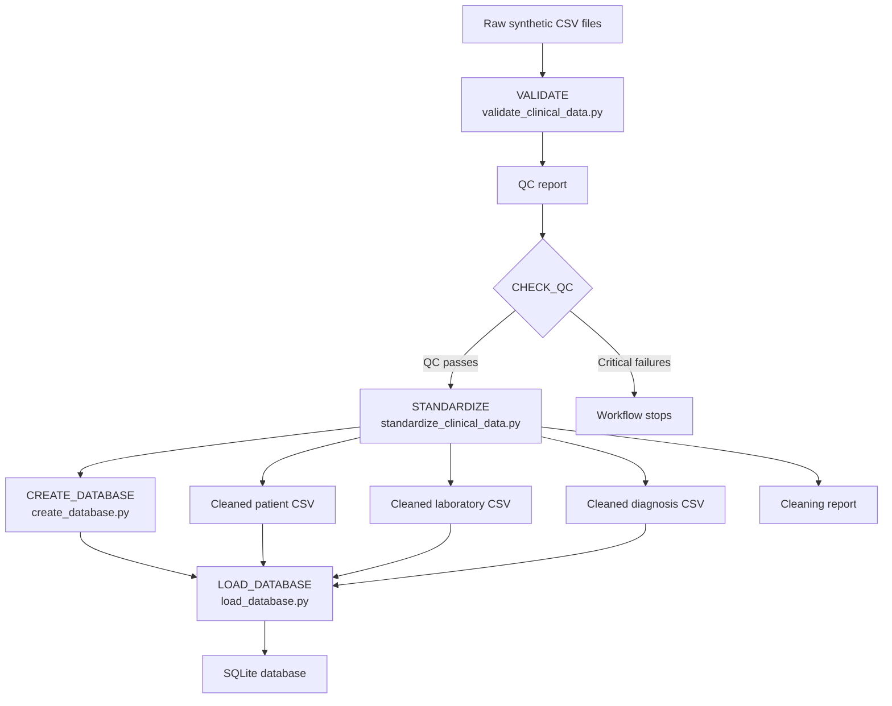

# ClinicalFlow Architecture

## Overview

ClinicalFlow is a reproducible workflow for managing synthetic clinical research datasets. Nextflow DSL2 coordinates Python-based validation and standardisation tasks and the creation and loading of a SQLite database.

## Workflow

Nextflow orchestrates the five processes and manages their execution and dependencies.

## Processing stages

| Stage | Responsibility | Main output |
|---|---|---|
| VALIDATE | Checks required fields, identifiers, values, dates, duplicates and patient references | QC report |
| CHECK_QC | Checks the validation report for critical failures | Pass or workflow termination |
| STANDARDIZE | Cleans column names, missing values, identifiers, dates, categories and numeric fields | Cleaned CSV files and cleaning report |
| CREATE_DATABASE | Creates the relational SQLite schema | Database schema |
| LOAD_DATABASE | Loads the cleaned datasets into SQLite | Populated SQLite database |

## Data model

The SQLite database contains three related tables:

- `patients` — one record per patient, with `patient_id` as the primary key.
- `laboratory` — laboratory measurements linked to patients through `patient_id`.
- `diagnoses` — diagnosis records linked to patients through `patient_id`.

The laboratory and diagnosis tables use foreign keys to reference the patients table.

## Outputs

The workflow publishes:

- A validation report under `qc/`.
- Cleaned CSV datasets under `processed/`.
- A cleaning report under `cleaning/`.
- A populated SQLite database under `database/`.

The output directory can be changed using the Nextflow `--outdir` parameter.

## Execution model

The current configuration uses the local Nextflow executor. Each process runs the relevant Python script, and Nextflow manages task dependencies, execution and work directories.