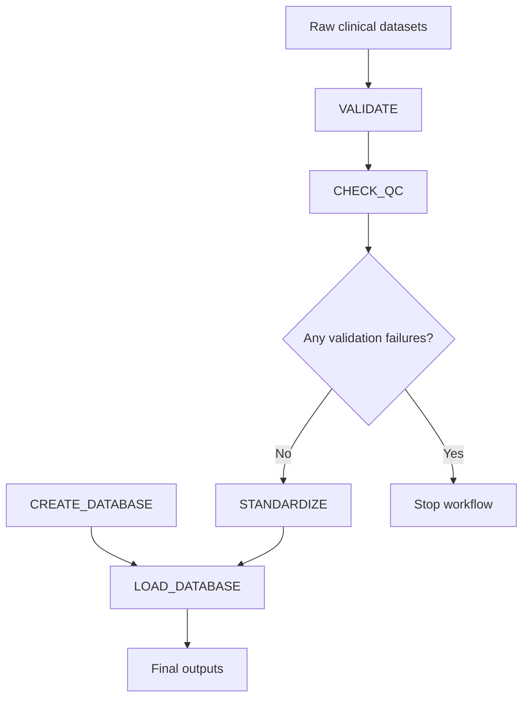
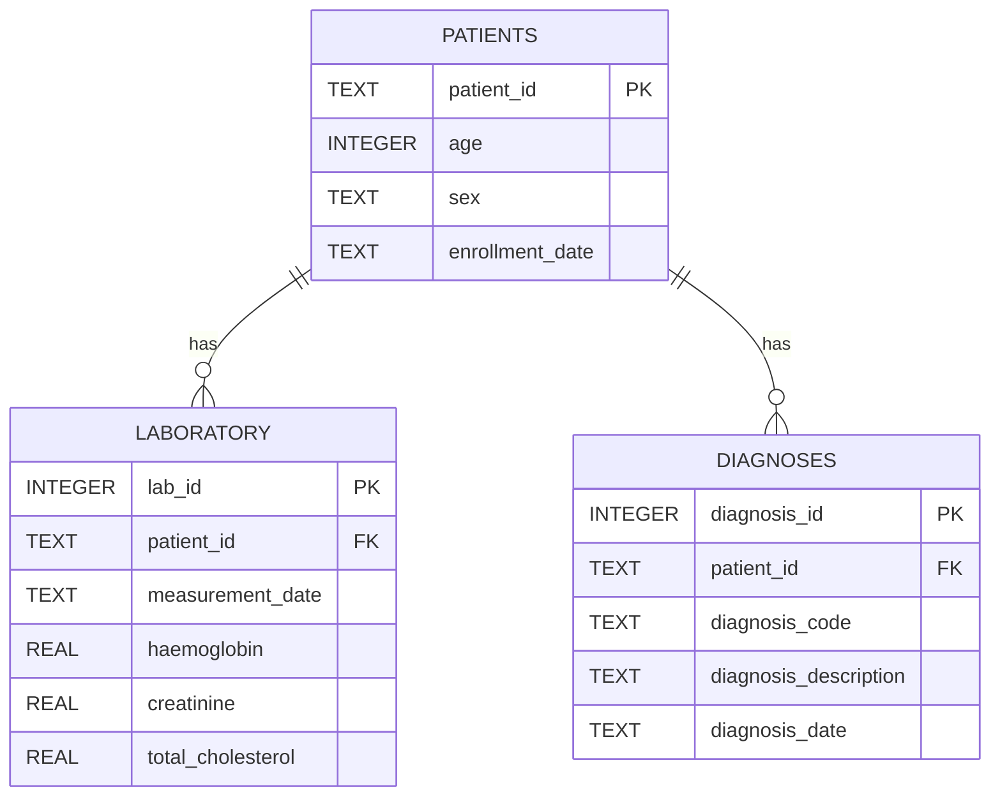

# ClinicalFlow Architecture

This document describes the processing workflow, execution environment, database structure and outputs of ClinicalFlow.

## Workflow overview

ClinicalFlow uses Nextflow DSL2 to orchestrate the processing of three synthetic clinical research datasets:

- Patients
- Laboratory measurements
- Diagnoses

The workflow has five processes. Database creation runs independently, while database loading waits for both database creation and data standardisation.



## Processing stages

| Stage | Description | Main output |
|---|---|---|
| VALIDATE | Checks patient, laboratory and diagnosis data for missing values, invalid values, duplicates and referential integrity issues. | qc_report.csv |
| CHECK_QC | Examines validation results and stops the workflow if any check has a FAIL status. | qc_pass.txt |
| STANDARDIZE | Standardises column names, identifiers, dates, missing values, numeric fields and diagnosis information. | Three cleaned CSV files and cleaning_report.csv |
| CREATE_DATABASE | Creates the SQLite database and its relational tables. | clinicalflow.db |
| LOAD_DATABASE | Loads the standardised datasets into the database. | Populated clinicalflow.db |

The validation stage produces a quality-control report. The CHECK_QC stage acts as a quality gate: the workflow continues only when no validation checks have a FAIL status. Warnings do not automatically stop the workflow.

## Containerised execution

ClinicalFlow supports Docker-based execution through Nextflow.

The Docker image provides a consistent Python runtime and installs the project dependencies specified in requirements.txt.

### Execution environment

| Component | Execution environment |
|---|---|
| Operating system | macOS host with Docker Desktop |
| Java | Host environment |
| Nextflow | Host environment |
| Workflow executor | Nextflow local executor |
| Python | Docker container |
| pandas | Docker container |
| NumPy | Docker container |
| SQLite | Python standard library inside the container |

The Docker image is built from the project Dockerfile:

```bash
docker build -t clinicalflow:1.0 .
```

Nextflow is configured to use the image for all pipeline processes:

```groovy
docker {
    enabled = true
}

process {
    executor = 'local'
    container = 'clinicalflow:1.0'
    errorStrategy = 'terminate'
}
```

Run the containerised workflow:

```bash
nextflow run main.nf -with-docker clinicalflow:1.0 \
  --raw_dir data/raw \
  --outdir results/docker
```

Nextflow stages the required input files and Python scripts into process working directories. Each process executes inside the Docker container. Generated outputs are published to the configured results directory.

The Docker image contains Python and the required Python dependencies. Java and Nextflow remain installed on the host system.

## Database structure

ClinicalFlow uses SQLite to integrate the three standardised datasets.

### Patients

| Column | Data type | Constraint |
|---|---|---|
| patient_id | TEXT | Primary key |
| age | INTEGER | Nullable |
| sex | TEXT | Nullable |
| enrollment_date | TEXT | Nullable |

### Laboratory

| Column | Data type | Constraint |
|---|---|---|
| lab_id | INTEGER | Primary key, autoincrement |
| patient_id | TEXT | Foreign key, NOT NULL |
| measurement_date | TEXT | Nullable |
| haemoglobin | REAL | Nullable |
| creatinine | REAL | Nullable |
| total_cholesterol | REAL | Nullable |

### Diagnoses

| Column | Data type | Constraint |
|---|---|---|
| diagnosis_id | INTEGER | Primary key, autoincrement |
| patient_id | TEXT | Foreign key, NOT NULL |
| diagnosis_code | TEXT | Nullable |
| diagnosis_description | TEXT | Nullable |
| diagnosis_date | TEXT | Nullable |

### Relationships



Each patient can have multiple laboratory measurements and multiple diagnoses.

Foreign keys link laboratory and diagnosis records to the patient table.

Indexes are created on patient identifiers and date columns to support database queries.

See [data_dictionary.md](data_dictionary.md) for the complete field descriptions and database schema.

## Output structure

The workflow generates the following output structure:

```text
results/
└── docker/
    ├── qc/
    │   └── qc_report.csv
    ├── processed/
    │   ├── patients_clean.csv
    │   ├── laboratory_clean.csv
    │   └── diagnoses_clean.csv
    ├── cleaning/
    │   └── cleaning_report.csv
    └── database/
        └── clinicalflow.db
```

The output directory can be changed using the Nextflow `--outdir` parameter.

## Reproducibility and quality assurance

ClinicalFlow uses several mechanisms to support reproducible execution and quality assurance:

- Nextflow DSL2 for workflow orchestration.
- Docker for a consistent Python execution environment.
- Pinned Python package versions in requirements.txt.
- Automated validation and quality-control checks.
- Cleaning reports documenting standardisation actions.
- SQLite constraints and relational integrity.
- pytest unit and integration tests.
- Ruff linting and formatting checks.
- GitHub Actions for automated testing.

The integration test executes the complete Nextflow pipeline and checks the expected output files, validation results and database record counts.
