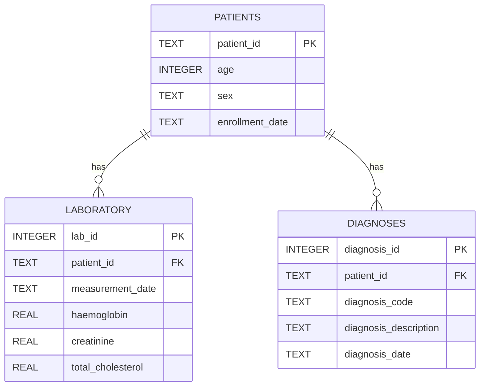

# ClinicalFlow Data Dictionary

## 1. Overview

ClinicalFlow manages three related synthetic clinical research datasets:

- Patients
- Laboratory measurements
- Diagnoses

The datasets are stored in a SQLite relational database. The `patient_id` field links laboratory measurements and diagnoses to individual patient records.

## 2. Patients

**Database table:** `patients`

**Description:** Contains demographic and study-enrolment information for each patient.

| Field | SQLite type | Key | Nullable | Description |
|---|---|---|---|---|
| patient_id | TEXT | Primary key | No | Unique patient identifier |
| age | INTEGER | | Yes | Patient age in years |
| sex | TEXT | | Yes | Recorded sex value |
| enrollment_date | TEXT | | Yes | Date of study enrolment |

## 3. Laboratory measurements

**Database table:** `laboratory`

**Description:** Contains laboratory measurements associated with patients. A patient can have multiple laboratory records.

| Field | SQLite type | Key | Nullable | Description |
|---|---|---|---|---|
| lab_id | INTEGER | Primary key | No | Automatically generated laboratory record identifier |
| patient_id | TEXT | Foreign key | No | References `patients.patient_id` |
| measurement_date | TEXT | | Yes | Date of laboratory measurement |
| haemoglobin | REAL | | Yes | Haemoglobin measurement |
| creatinine | REAL | | Yes | Creatinine measurement |
| total_cholesterol | REAL | | Yes | Total cholesterol measurement |

## 4. Diagnoses

**Database table:** `diagnoses`

**Description:** Contains diagnosis records associated with patients. A patient can have multiple diagnosis records.

| Field | SQLite type | Key | Nullable | Description |
|---|---|---|---|---|
| diagnosis_id | INTEGER | Primary key | No | Automatically generated diagnosis record identifier |
| patient_id | TEXT | Foreign key | No | References `patients.patient_id` |
| diagnosis_code | TEXT | | Yes | Diagnosis classification code |
| diagnosis_description | TEXT | | Yes | Text description of the diagnosis |
| diagnosis_date | TEXT | | Yes | Date of diagnosis |

## 5. Database relationships

The database uses `patient_id` to maintain relationships between the three tables.

- `patients.patient_id` is the primary key.
- `laboratory.patient_id` references `patients.patient_id`.
- `diagnoses.patient_id` references `patients.patient_id`.
- Each patient can have zero or more laboratory records and diagnosis records.

## 6. Indexes

The database includes indexes to support common lookups:

| Table | Index | Field |
|---|---|---|
| patients | Primary-key index | patient_id |
| laboratory | idx_laboratory_patient_id | patient_id |
| laboratory | idx_laboratory_measurement_date | measurement_date |
| diagnoses | idx_diagnoses_patient_id | patient_id |
| diagnoses | idx_diagnoses_date | diagnosis_date |

## 7. Data considerations

- Patient identifiers are used to link records across datasets.
- Date fields are stored as SQLite `TEXT` values.
- Laboratory measurements are stored as `REAL` values.
- Missing-value handling and validation are performed during data processing.
- The SQLite schema permits some fields to be nullable; application-level validation applies additional data-quality rules.
- Measurement units and diagnosis coding standards are not explicitly defined in this demonstration dataset.

## 8. Data privacy

All records are synthetic and created for software development and demonstration. No real patient information is included.
